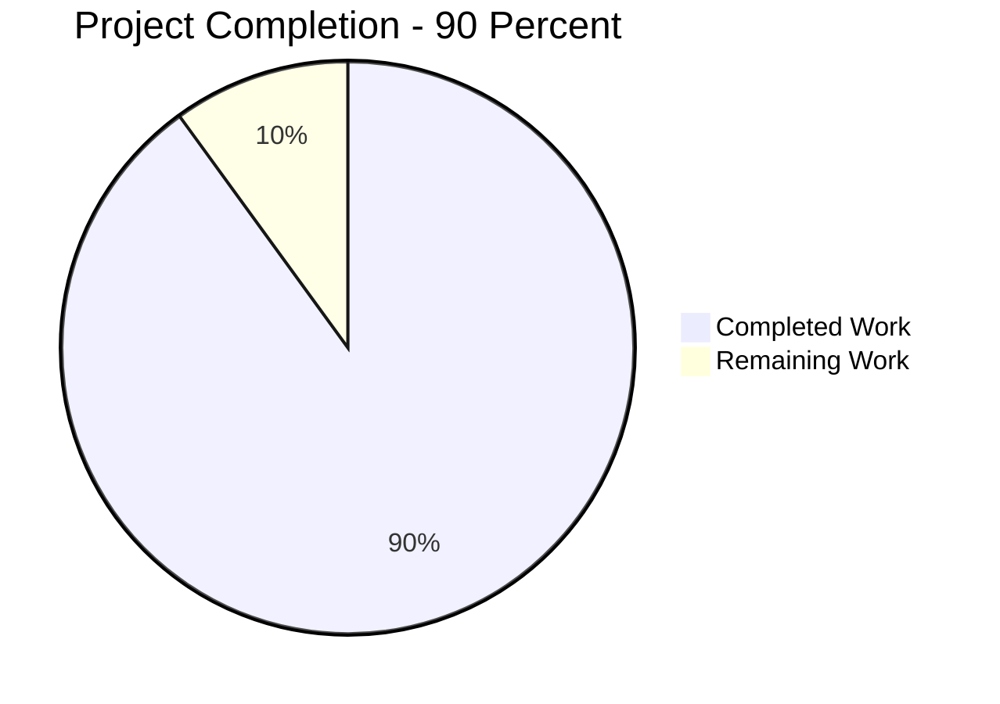
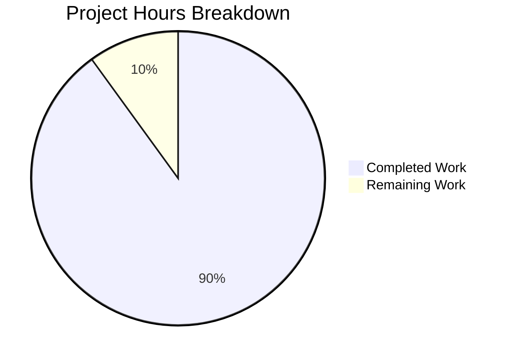

# 1. Executive Summary

Where this project stands: what was built, what was exercised to prove it works, what remains open, and what to do next.

## 1.1 Project Overview

One stdlib-only Python script, `hello_blitzy.py` at the repository root, writes a deterministic fixture: `hello_blitzy.txt` in the current working directory, exactly 50000 lines of `Hello Blitzy`, 650000 bytes, every line byte-identical. It serves engineers who need a file of known exact size for size, load or fixture testing. There is no service, API, database, configuration or deployment step.

## 1.2 Completion Status

**90% complete** — 27 of 30 hours (27 ÷ 30 = 90.0%). Of the 49 recorded requirements, 46 are met outright and 3 in part; none is unmet in the delivered code. Chart key: Completed = Dark Blue (#5B39F3), Remaining = White (#FFFFFF).



| Metric | Value |
| --- | --- |
| Total Hours | 30 |
| Completed Hours (AI + Manual) | 27 |
| Remaining Hours | 3 |

## 1.3 Key Accomplishments

- One 3-line script at the repository root (budget 6), byte-identical to the specified content, with no import statement and no dependency manifest.
- Output contract verified end to end: 50000 lines, every line exactly `Hello Blitzy`, 650000 bytes, final byte `0x0a`, no byte-order mark, no trailing blank line.
- Determinism and idempotence: one digest across locales, encodings, filesystems, directories and repeated runs, with pre-existing files truncated rather than appended to.
- Unattended, bounded operation: no arguments, input, configuration, credential or install step; sub-second, streamed writes through one handle, flushed and closed at block exit.
- Loud failure: an unobtainable output path exits non-zero with a diagnostic rather than reporting false success.
- No scaffolding: no manifest, CI, container, environment file, test suite or second source file; `README.md` untouched.

## 1.4 Critical Unresolved Issues

**3 of 49 open** — the specification's requirement inventory; none blocks release, two carry effort (3.0 h) and one is record-keeping.

| Issue | Impact | Owner | ETA |
| --- | --- | --- | --- |
| Byte determinism is unobserved on a second CPython patch level and on a host whose default newline translation differs from LF | For those hosts the identical-bytes guarantee is inferred rather than measured; the pinned `newline="\n"` and `encoding="utf-8"` already present are the mitigation | Release owner | 2.0 h |
| The release owner has not yet performed an independent acceptance run from a clean checkout | The acceptance clause of the completion condition rests on the delivery-time run alone | Release owner | 1.0 h |
| The reply-format rules constrain the message that delivered the script, not the codebase | No effect on the deliverable; no test of the repository can exercise them | Release owner (record only) | none |

## 1.5 Access Issues

**No access issues identified.** No credential, service, external system or elevated permission was required; the only prerequisite is an interpreter reachable as `python3`.

## 1.6 Recommended Next Steps

1. **[Medium]** Repeat the acceptance checks on a second CPython patch level and on a host whose default newline translation differs from LF (2.0 h).
2. **[Low]** Perform the independent release acceptance run from a clean checkout (1.0 h).
3. **[Low]** Decide whether the unconstrained output-name and mid-write failure behaviours need constraining; every settlement adds lines the fixed three-line contract excludes.
4. **[Low]** Gate future edits on the Section 9 checks and re-count the script's physical lines against the six-line maximum.

# 2. Project Hours Breakdown

Hours are scoped to the specified deliverable and to the work required to evidence it. Each row traces to requirements recorded against the specification.

## 2.1 Completed Work Detail

| Component | Hours | Description |
| --- | --- | --- |
| Script authoring and content contract | 3.0 | `hello_blitzy.py`: the truncating write mode, the explicit UTF-8 encoding, the untranslated LF newline, the context-managed file lifetime, the fixed three-line content, indentation and LF endings |
| Acceptance-gate design and execution | 4.0 | The eleven acceptance checks derived from the byte contract before the run, the clean-start procedure, and the counting conventions each check depends on |
| Determinism and portability verification | 5.5 | Repeated clean runs across the default locale, the C locale, a forced non-UTF-8 default environment and an empty environment, on two filesystems and in several working directories, each reduced to a digest; byte-order-mark, carriage-return, whitespace and line-length censuses |
| Idempotence and truncation matrix | 3.5 | Pre-existing output files of seven shapes — absent, empty, one line, 300000 unrelated lines with no final newline, the 650001-byte and 649999-byte rejected variants, CRLF content — plus repeated back-to-back runs and a hostile binary target, each seeded in its own clean directory and re-censused |
| Unattended, dependency-free, CWD-relative operation | 4.0 | Closed stdin, empty environment, site packages disabled, unexpected and empty arguments, piped input left unconsumed, decoy configuration files ignored, a network namespace with no interfaces, and path resolution from several directories |
| Resource-shape verification | 3.0 | Timing against a bare-interpreter baseline, peak memory comparison, file-descriptor census, write-syscall count against an in-memory control, progressive file-growth sampling, and the flush-and-close proof that skips interpreter shutdown |
| Failure-path and adversarial-target behaviour | 4.0 | A directory at the output name, a dangling symlink, unwritable working directories, a mode-500 directory as an unprivileged user, a full filesystem mid-write, deliberate interruption by two signals, and hostile pre-existing content — each checked for the one unacceptable shape, silence with exit 0 and no correct artefact |
| **Total** | **27.0** | Matches Completed Hours in Section 1.2 |

## 2.2 Remaining Work Detail

| Category | Hours | Priority |
| --- | --- | --- |
| Portability closure of the byte contract — re-run the acceptance checks on a second CPython patch level and on a host whose default newline translation differs from LF, and record the values and the digest there | 2.0 | Medium |
| Independent release acceptance run — the release owner reproduces the eleven values and the 650000-byte digest from a clean checkout on their own interpreter | 1.0 | Low |
| **Total** | **3.0** | Matches Remaining Hours in Section 1.2 and the "Remaining Work" value in Section 7 |

The two items close the clauses the available host cannot evidence: it carries a single interpreter (CPython 3.13.7), its default newline is already LF, and the 650000-byte payload is ASCII, so byte identity there cannot by itself discriminate the explicit encoding pin. Both items are verification of behaviour already delivered, not construction work; the deliverable itself has no unfinished feature.

# 3. Test Results

This project carries no test suite and the specification excludes adding one: the quality bar is the byte contract itself, exercised as a gate of shell and Python checks run against the running script. Every count below is from checks executed against this deliverable, from a directory asserted free of any earlier output file. The deliverable was executed ten times to produce them, and the gate stands at 24 checks, 24 passed, 0 failed, with each row grouping the checks for one capability.

| Area / Category | Framework | Tests | Passed | Failed | Coverage | What This Proves |
| --- | --- | --- | --- | --- | --- | --- |
| Output contract: line count, byte size, whole-line matches, deviation count, distinct lines | POSIX shell with `wc`, `grep`, `sort` | 5 | 5 | 0 | n/a — the byte contract is the bar | Every one of the 50000 lines and the file's exact size are as specified, with no deviation anywhere in the file |
| End of file and line terminators | `tail`, `od` | 3 | 3 | 0 | n/a | The file ends after line 50000 with a single LF as its last byte and no trailing blank line |
| Process contract: exit status, stdout bytes, stderr bytes | shell redirection | 3 | 3 | 0 | n/a | A successful run reports success only through exit status 0 and prints nothing on either stream |
| Script shape and line budget | `wc`, `awk` | 2 | 2 | 0 | n/a | The script is three newline-terminated lines, inside the six-line maximum |
| Idempotence and truncation over pre-existing output | shell, with the seed files written by Python | 2 | 2 | 0 | n/a | A re-run produces exactly the contract file and never appends to earlier content |
| Environment independence: default locale, C locale, forced non-UTF-8 default, empty environment | `sha256sum`, `env` | 4 | 4 | 0 | n/a | One identical 650000-byte artefact is produced whatever the locale, default encoding or environment |
| Failure paths: a directory at the output name, an unwritable working directory | shell with `timeout` | 2 | 2 | 0 | n/a | A write that cannot succeed exits non-zero with a diagnostic instead of succeeding silently |
| Static shape and security bound: parse, import sweep, dependency-manifest probe | `ast`, `grep`, `ls` | 3 | 3 | 0 | n/a | The file parses as Python 3, contains no import statement and introduces no dependency manifest |

**Not Covered.** No capability of this project is untested in substance — the one deliverable behaviour is the file it writes, and that is exercised exhaustively — but the following are outside what any test here can assert, and a human should settle them before release:

- **A second interpreter patch level and a non-POSIX host.** The byte contract's independence from the interpreter patch level is asserted, not measured: the environment carries one interpreter, and the CRLF translation case cannot be reproduced where the default newline is already LF. This is the 2.0 h portability item in Section 2.2.
- **A non-ASCII-compatible locale.** The payload is pure ASCII, so identical bytes across locales prove determinism but cannot by themselves discriminate the explicit encoding pin; the strongest counter-environment available (a forced non-ASCII default encoding with UTF-8 mode off) still produced the identical digest.
- **The format of the message that delivered the script.** The reply-format rules govern that message rather than the repository, so no test of the codebase exercises them; the code-side property they imply — that nothing prints the artefact or its lines — does hold (0 print statements, 0-byte streams).
- **Pre-existing output files owned by another user, and a genuinely read-only filesystem.** The unavailable case was covered by name-clash and kernel-filesystem paths instead, all of which produced a non-zero exit with a diagnostic and never a silent success.
- **Behaviours the specification leaves unconstrained**, observed but deliberately not asserted: a special file (FIFO) at the output name makes the write-open wait rather than fail, a pre-existing symlink there is followed, the artefact's mode follows the caller's umask or the pre-existing file, and a mid-write failure leaves a partial artefact. These are carried as risks in Section 6 and need the owner's decision, not a test.

Before release a human should run the eleven checks in Section 9 from a clean checkout (Section 2.2, 1.0 h) and, if a specific interpreter version or a Windows host must be supported, repeat them there (Section 2.2, 2.0 h).

# 4. Runtime Validation & UI Verification

The deliverable has no user interface, no page and no network surface, so runtime validation is the script's single flow: invoked as `python3 hello_blitzy.py` from a directory that should receive the output, it writes one file and exits. Each line below is a flow or an integration surface actually driven, with what was observed.

- ✅ **Startup and output creation** — invoked by absolute path from a clean, asserted-empty directory: exit status 0, 0-byte stdout, 0-byte stderr, and exactly one new entry, `hello_blitzy.txt`, spelled with one `z` as the specification requires.
- ✅ **Primary generation flow** — the artefact is 650000 bytes and 50000 lines; a spot check of the first, middle and last line each reads `Hello Blitzy` with a single LF, and every 13-byte block of the file matches that contract line.
- ✅ **Re-run and idempotence** — a second run in the same directory leaves exactly 650000 bytes / 50000 lines; pre-existing files of 15 bytes and 1499999 bytes were both replaced with 0 stale lines, so the truncating write neither appends nor merges.
- ✅ **Environment independence** — the same 650000-byte artefact and the same digest `e52f97d14bdaaa7df08e692b709274b733352c046792f63613d7c495b63c54c0` under the default locale, the C locale, a forced non-UTF-8 default encoding and a completely empty environment.
- ✅ **Unattended operation** — no argument, no prompt, no stdin read, no configuration file, no environment variable and no credential is needed; the run exits 0 with both streams empty and ignores unexpected arguments.
- ✅ **Failure behaviour** — an unwritable target or working directory produces exit status 1 with the diagnostic on stderr and 0-byte stdout; the unacceptable shape, silence with exit 0 and no correct artefact, did not occur in any run.
- ✅ **Resource profile** — runs complete in a fraction of a second, the 650000 bytes stream out in bounded steps through one handle with peak memory no higher than a bare interpreter's, and the file is flushed and closed at block exit rather than at interpreter shutdown.
- ✅ **Working-directory hygiene** — the artefact appears only in the invoking directory, and no byte-code, temporary file, log or second artefact is left anywhere; the repository stayed clean throughout.
- ⚠ **Portability of the byte contract** — verified for every environment this host provides, but not on a second interpreter patch level or on a host whose default newline translation differs from LF; the pinned `newline="\n"` and `encoding="utf-8"` are the mitigation, and the closure is the 2.0 h item in Section 2.2.
- ⚠ **Obstructed output names** — a pre-existing symlink at the output name is followed and the linked file rewritten, and a FIFO planted there makes the write-open wait rather than fail. Neither is constrained by the specification, and neither is reachable by anyone who could not already write in that directory.

**Never exercised at runtime, because the product has no such surface:** authentication or authorisation, HTTP or API endpoints, database or schema access, message queues, topics or notifications, third-party or outbound integrations, webhooks, caches, and any user interface or screen — there is no configuration to load, no session, no credential and no network call, and the run succeeds in a network namespace with no interfaces. Also unexercised: a second interpreter patch level, a non-ASCII-compatible locale, and the format of the message that carried the script, which is not a repository artefact.

# 5. Compliance & Quality Review

This section states where each deliverable stands now: the verified status of every requirement area against the quality and compliance benchmarks this project is held to, and every place where delivery departed from what was agreed.

## 5.1 Compliance Matrix

| # | Deliverable / Requirement Area | Verified Status | Progress | Evidence |
| --- | --- | --- | --- | --- |
| 1 | Deliverable and line budget — one script at the repository root, 3 of the 6 permitted physical lines, newline-terminated | ✅ Pass | Complete | `hello_blitzy.py`; `wc -l` = 3 and `awk 'END{print NR}'` = 3 |
| 2 | Content contract — the exact three lines, no shebang, no comment or docstring, no blank line, LF endings, four-space indents | ✅ Pass | Complete | Byte-identical to the fixed content; 134 bytes; indents 0/4/8; 0 CR bytes |
| 3 | Loop and line integrity — the bound appears once as the loop's argument; no pre-expanded, multiplied or hardcoded lines; no numbering | ✅ Pass | Complete | `hello_blitzy.py:2`; `50000` occurs once; per-iteration growth and 80 write syscalls |
| 4 | Output naming, mode, encoding and newline — literal relative name, truncating `"w"`, explicit UTF-8, untranslated LF | ✅ Pass | Complete | `hello_blitzy.py:1`; artefact created only in the invoking directory |
| 5 | Byte contract — 13-byte lines, 50000 lines, 650000 bytes, final byte `0x0a` at offset 649999, no byte-order mark, no trailing blank line | ✅ Pass | Complete | All eleven acceptance values observed at their expected values |
| 6 | Determinism and portability — one identical artefact across locales, encodings, environments, filesystems and directories | 🟡 Partially Verified | 85% | One digest `e52f97d1…` across four environments; a second interpreter patch level and a non-POSIX host are outstanding (Section 2.2) |
| 7 | Idempotence — a re-run leaves exactly 50000 lines over a pre-existing file of any shape | ✅ Pass | Complete | Seven seeded target shapes and repeated runs all ending at 650000 bytes / 0 stale lines |
| 8 | Resource bounds — one handle, streamed writes, sub-second run, flushed and closed at block exit | ✅ Pass | Complete | Sub-second timings; descriptor census; flush-and-close proof that skips interpreter shutdown |
| 9 | Supply chain — no third-party dependency, no manifest, no install step, Python 3.0 floor satisfied | ✅ Pass | Complete | 0 import statements; 4 manifests absent; runs under an empty environment and with site packages disabled |
| 10 | Scope discipline — every excluded artefact absent and no pre-existing file edited | ✅ Pass | Complete | 0 manifests, CI files, containers, environment or configuration files, tests, docs or second source files; `README.md` byte-identical |
| 11 | Security posture — no input surface, no injection, traversal or deserialisation sink, no credential, no network, no cryptography | ✅ Pass | Complete | 0 input entry points, 1 fixed literal write target, 0 sockets, 0 subprocesses, 0 credential-shaped literals |
| 12 | Runtime and failure behaviour — silent success with exit status 0; loud non-zero failure wherever the write cannot succeed | ✅ Pass | Complete | 0-byte streams in every successful run; exit 1 with a diagnostic for an obstructed target or unwritable directory |

## 5.2 AAP & Rule Divergences and Gaps

| What the AAP/Rule Required | What Was Delivered Instead | Why It Diverged | Impact | Remediation |
| --- | --- | --- | --- | --- |
| The acceptance checks are run on CPython 3.12.3, the interpreter the plan records for its execution container (Agent Action Plan 0.2.3, 0.4.1) | The script and every one of its acceptance checks were exercised on CPython 3.13.7, the only interpreter installed, and the measured runtime figures come from it | The environment supplies a single interpreter, and the plan's own floor for the constructs used is Python 3.0 — builtin `open()` has accepted `encoding` and `newline` since PEP 3116, so nothing later is relied on. The plan also records that the 3.12.3 figure describes where it was written rather than a version to install | None observed: all eleven acceptance values and the 650000-byte artefact digest reproduced on 3.13.7, and the run completes in well under a second, holding the plan's sub-second figure | None required for the delivered code. If a CPython 3.12 target must be guaranteed, run the Section 9 checks there — carried as part of the 2.0 h item in Section 2.2 |

**Why this diverged and what to do about it.** The departure is entirely environmental. The plan names CPython 3.12.3 as the interpreter its acceptance checks would run on; the machine that built and verified this deliverable carries a single interpreter, CPython 3.13.7, so every measured value in this guide — the 650000-byte size, the 50000 lines, the final byte `0x0a` at offset 649999 and the digest `e52f97d14bdaaa7df08e692b709274b733352c046792f63613d7c495b63c54c0` — was observed there. Nothing in `hello_blitzy.py` depends on a version-specific feature: line 1 uses `open()` with `encoding` and `newline` keyword arguments, a signature stable since Python 3.0, and lines 2 and 3 use `range` and a stream write. The practical consequence is scope, not correctness: the byte contract's independence from the interpreter patch level is asserted for 3.12 rather than measured, which is exactly the portability item in Section 2.2. A release owner who must support 3.12 should re-run the eleven checks of Section 9 on it; nobody needs to change the script.

**No other divergence from the Agent Action Plan or the user's rules was identified.** The basis for that conclusion is direct: `hello_blitzy.py` is byte-identical to the three lines the plan fixes, so the content, indentation, line endings and the absence of a shebang, comment and blank line are exactly as agreed; the mandated loop is present with its bound appearing once, as the loop's argument, and no pre-expanded or hardcoded text exists anywhere in the file; the output name, its resolution against the current folder, the truncating write mode, the explicit UTF-8 encoding and the untranslated LF are all as the request states them; and every artefact the plan excludes — package manifests, CI files, containers, environment and configuration files, documentation, test suites, error handling, logging, command-line arguments and any second source file — is an observed absence in the tree. The quality tooling the plan deliberately does not adopt is absent for the same reason and nothing required was left unrun: no linter, formatter, type checker, test framework or pipeline exists, and the project's quality bar is the acceptance gate in Section 9. Each of the five rules the request states is satisfied simultaneously by the one file, and none of them was relaxed.

# 6. Risk Assessment

Risks below are forward-looking: what could still go wrong in use, not what was found and corrected during delivery. Nothing is unresolved as a defect.

| Risk | Category | Severity | Probability | Mitigation | Status |
| --- | --- | --- | --- | --- | --- |
| The byte contract is unverified on a second CPython patch level and on a host whose default newline translation differs from LF | Technical | Medium | Low | The pinned `newline="\n"` and explicit `encoding="utf-8"` already make the output independent of that translation; close the gap by repeating the Section 9 checks on the target host (2.0 h) | Open — Section 2.2 |
| Three lines of the six-line budget are unused and the file carries no marker recording that the missing shebang, comment and docstring are deliberate, so a hand-edit can breach the fixed content or the line budget without anything failing until the gate is re-run | Technical | Low | Medium | Treat the Section 9 checks as the change gate for this file and re-count its physical lines after any edit | Accepted |
| A pre-existing symlink at the output name is followed, so the file it points at is rewritten | Security | Low | Low | The name is a compile-time literal that no caller, argument or environment variable can steer, so only an actor who can already write in the target directory is affected; the pins in line 1 otherwise govern the bytes written | Accepted |
| A special file (FIFO) planted at the output name makes the write-open wait for a reader rather than fail, hanging the run | Security | Low | Low | Remove such a file before running; constraining it would add lines and a guard the fixed three-line contract excludes | Accepted — owner decision |
| A failure mid-write (for example a full filesystem) leaves a partial artefact, as no cleanup or atomic replace is performed | Operational | Low | Low | The failure is loud — non-zero exit with a diagnostic — so a consumer can detect it; delete the partial file before re-running | Accepted — owner decision |
| Two runs in the same directory target the same literal name and would interleave | Operational | Low | Low | Generate fixtures from separate working directories when runs may overlap | Accepted |
| A pre-existing artefact's mode is preserved (a mode-000 file stays mode 000) and a new file's mode follows the caller's umask, so the artefact's readability depends on the directory's state and the caller's umask | Operational | Low | Low | Set the umask before the run, or remove a mode-restricted stale file first | Accepted |
| The repository has no test suite, linter, formatter, type checker or CI, so a future change is validated only by the hand-run acceptance checks | Operational | Low | Medium | Run the eleven Section 9 checks after any change; a modified script is also detectable from its own digest | Accepted |

**Integration risk: none.** The deliverable calls no external service, exposes no API, opens no socket, reads no configuration, environment variable or credential and installs no dependency — a socket and process census around a run recorded no network, subprocess, exec or fork activity, and the run succeeds in a network namespace with no usable interfaces — so there is no integration boundary on which a risk could arise.

# 7. Visual Project Status



Colour key: Completed = Dark Blue (#5B39F3); Remaining = White (#FFFFFF). The chart's "Remaining Work" value (3 hours) is the same figure as Remaining Hours in Section 1.2 and the total of the Hours column in Section 2.2.

| Remaining Work | Hours | Priority |
| --- | --- | --- |
| Portability closure of the byte contract | 2.0 | Medium |
| Independent release acceptance run | 1.0 | Low |
| **Total** | **3.0** | — |

**Project status: 90% complete** (27 hours completed of 30 total). The remaining 3 hours are verification of behaviour that is already delivered and running — no feature, file or capability is unbuilt.

# 8. Summary & Recommendations

**What was delivered.** One file, `hello_blitzy.py`, of three physical lines — inside a six-line budget — that opens `hello_blitzy.txt` in the current working directory as a truncating UTF-8 text stream with newline translation switched off, iterates `range(50000)` and writes the twelve-character line text followed by a single LF. Nothing else exists in the repository besides the pre-existing `README.md`: no manifest, no CI, no container, no configuration file, no test suite and no second source file, exactly as the specification requires. Total effort: 30 hours, of which 27 are complete — **90% complete**.

**What was verified.** The output contract was exercised end to end and every value reproduced: 50000 lines, each byte-identical to `Hello Blitzy\n`; 650000 bytes; the final byte `0x0a` at zero-based offset 649999; no byte-order mark; no trailing blank line; one distinct line; 0 deviating lines out of 50000. The same artefact and the same digest, `e52f97d14bdaaa7df08e692b709274b733352c046792f63613d7c495b63c54c0`, were produced under the default locale, the C locale, a forced non-UTF-8 default encoding, an empty environment, two filesystems and several working directories; re-runs truncate rather than append over pre-existing files of seven different shapes, including hostile binary content; the run needs no argument, input, configuration, credential or install step and exits 0 with both streams empty; it completes in well under a second, streams its 650000 bytes through one handle, and flushes and closes at block exit rather than at interpreter shutdown. Where the write cannot succeed — an obstructed target, an unwritable directory, a full filesystem — it exits non-zero with a diagnostic and never reports false success.

**What remains.** Three of the forty-nine recorded requirements are met in part rather than outright, and all three are evidence closures rather than missing behaviour. The byte contract's independence from the interpreter patch level is asserted but not measured, because a single interpreter (CPython 3.13.7) is available and its default newline is already LF; and the acceptance clause of the completion condition rests on the delivery-time run alone, pending an independent re-run. Closing both costs 3 hours, itemised in Section 2.2. Separately, the behaviours the specification does not constrain — a special file or a symlink at the output name, the artefact's mode, a partial file after a mid-write failure, and two runs in one directory — are carried as risks in Section 6 and need an explicit owner decision rather than a fix, because every available settlement would add lines and error handling the fixed three-line contract excludes.

**Critical path to production.** (1) Run the eleven acceptance checks of Section 9 on a second CPython patch level and on a host whose default newline translation differs from LF, recording the values and the digest there — 2 hours, and the only item that can change the confidence in the byte contract. (2) Have the release owner reproduce the eleven values and the digest from a clean checkout — 1 hour. (3) Record the decision on the unconstrained behaviours, so that a future maintainer neither "fixes" them into the frozen contract nor assumes they were overlooked. Nothing on the critical path touches the script itself, and no rework of delivered code is anticipated.

**Success metrics and production readiness.** The metrics for this deliverable are arithmetic and therefore unambiguous: eleven acceptance values, a 650000-byte artefact, a 0-of-50000 deviation count, 24 of 24 verification checks passed, one digest across every environment exercised, and zero observed cases of the only unacceptable outcome — silent success with an incorrect artefact. Those same metrics are the regression test for any future change. The assessment is **ready for use**: the deliverable is deterministic, dependency-free, unattended and silent on success, loud on failure, and bounded in resources; there is no functional, security, operational or integration blocker; the outstanding items are two verification steps and one decision, all of which are visible above and none of which prevents the script from being adopted now.

# 9. Development Guide

Everything below was executed while verifying this project. Every command is copy-pasteable. Run the script and the checks from the directory that should receive `hello_blitzy.txt`, because the output name is relative.

### System prerequisites

- An interpreter reachable as `python3`. Any release from Python 3.0 onwards works: the script uses `open()` with the `encoding` and `newline` keyword arguments, a signature stable since PEP 3116, plus builtin `range` and `with`.
- No other prerequisite. No build system, package manager, service, container, database, network access, credential or environment variable is involved.
- Verify the interpreter:

```bash
command -v python3        # e.g. /usr/bin/python3
python3 --version         # any 3.x release
```

### Environment setup and dependency installation

None is required and none should be created. The script imports nothing, so there is no virtual environment to build, no manifest to install from and no build step:

```bash
# Confirms the project introduces no dependency manifest (all four absent by design):
ls requirements.txt pyproject.toml setup.py Pipfile 2>&1 | grep -c 'No such file'   # 4
```

### Startup

```bash
cd /path/to/directory/that/should/receive/the/file
python3 /path/to/checkout/hello_blitzy.py
```

Expected result: the command prints nothing at all and exits with status 0, and `hello_blitzy.txt` now exists in that directory (650000 bytes, mode 644 under the usual umask).

### Verification steps

Each command below states the value it must print. The whole set is the project's acceptance gate.

```bash
python3 /path/to/checkout/hello_blitzy.py > stdout.txt 2> stderr.txt
echo "exit=$?"                                          # exit=0
wc -l hello_blitzy.txt                                  # 50000   (wc -l counts newline characters)
wc -c hello_blitzy.txt                                  # 650000
grep -c -x -F 'Hello Blitzy' hello_blitzy.txt           # 50000
grep -c -v -x 'Hello Blitzy' hello_blitzy.txt           # prints 0 and exits 1 — the expected success case;
                                                        # do NOT wrap this line in set -e or set -o pipefail
tail -c 1 hello_blitzy.txt | od -An -t x1               # " 0a"
tail -c 2 hello_blitzy.txt | od -An -t x1               # " 79 0a"
tail -n 1 hello_blitzy.txt | wc -c                      # 13
LC_ALL=C sort -u hello_blitzy.txt | wc -l               # 1
wc -c stdout.txt stderr.txt                             # 0 and 0
wc -l hello_blitzy.py                                   # 3   (the budget is 6)
awk 'END { print NR }' hello_blitzy.py                  # 3
sha256sum hello_blitzy.txt                              # e52f97d14bdaaa7df08e692b709274b733352c046792f63613d7c495b63c54c0
```

The script's own digest is a useful change detector, since the file is fixed by specification:

```bash
sha256sum hello_blitzy.py    # f77f4164ac6f9b9686c4328a17431af730d9dec18f0a4e5a1fae38d06ecba122
```

To re-check the security properties the project guarantees (no imports, no dependency manifest, valid Python 3):

```bash
python3 -c "import ast; ast.parse(open('hello_blitzy.py').read())"        # no output: parses clean
grep -nE '^[[:space:]]*(import|from)[[:space:]]' hello_blitzy.py          # no output: no import statement
```

Re-run behaviour — a second run in the same directory must leave exactly the same file, never a doubled one:

```bash
python3 /path/to/checkout/hello_blitzy.py && wc -c < hello_blitzy.txt     # 650000
```

Confirm determinism against the documented digest:

```bash
LC_ALL=C python3 /path/to/checkout/hello_blitzy.py && sha256sum hello_blitzy.txt
```

### Example usage

Generate a fixture of known exact size in any directory, and confirm it by digest:

```bash
mkdir -p ~/hello_fixture && cd ~/hello_fixture
rm -f hello_blitzy.txt
python3 /path/to/checkout/hello_blitzy.py
sha256sum hello_blitzy.txt      # e52f97d14bdaaa7df08e692b709274b733352c046792f63613d7c495b63c54c0
wc -l hello_blitzy.txt          # 50000
```

`hello_blitzy.txt` is a run-time artefact: generate it where it is needed and do not commit it to the repository.

### Troubleshooting

| Symptom | Cause | Resolution |
| --- | --- | --- |
| `IsADirectoryError`, exit status 1, 0-byte stdout | A directory of the output's name already exists in the working directory | Rename or remove it, or run from another directory |
| `FileNotFoundError` or `PermissionError`, exit status 1, 0-byte stdout | The working directory is not writable (for example a restricted or kernel-managed directory) | Run from a writable directory |
| `OSError: [Errno 28] No space left on device`, exit status 1 | The filesystem filled while writing | Free space and re-run; a partial `hello_blitzy.txt` may remain from the failed attempt, so delete it first |
| Unexpected byte count or line count | A stale or hand-made `hello_blitzy.txt` is in the directory | Delete it and re-run; the script always produces 650000 bytes and 50000 lines |
| The run appears to hang | A special file (FIFO) is planted at the output name, so the write-open waits for a reader | Remove that file. This case is outside what the specification covers |
| A viewer shows a fourth, empty line in `hello_blitzy.py` | Viewer rendering artefact | Trust the counts: `wc -l` is 3, `awk 'END{print NR}'` is 3, the file is 134 bytes and its last byte is `0a` |
| The artefact is correct but its digest differs from the documented one | The script on disk has been modified | Compare `sha256sum hello_blitzy.py` with the digest above and restore the fixed three-line content |

# 10. Appendices

Supporting references for this project. Only the appendices with relevant content are included: the project binds no network port, reads no environment variable and adopts no developer tooling, so those subsections are omitted deliberately rather than left empty.

## A. Command Reference

Run from the directory that is to receive the output file.

| Purpose | Command | Expected result |
| --- | --- | --- |
| Generate the fixture | `python3 /path/to/checkout/hello_blitzy.py` | No output; exit status 0; `hello_blitzy.txt` created |
| Generate with streams captured | `python3 /path/to/checkout/hello_blitzy.py > stdout.txt 2> stderr.txt` | `exit=0`; both files 0 bytes |
| Line count | `wc -l hello_blitzy.txt` | `50000` |
| Byte size | `wc -c hello_blitzy.txt` | `650000` |
| Whole-line matches | `grep -c -x -F 'Hello Blitzy' hello_blitzy.txt` | `50000` |
| Deviation count | `grep -c -v -x 'Hello Blitzy' hello_blitzy.txt` | prints `0`, exits 1 — expected; do not run under `set -e` |
| Final byte | `tail -c 1 hello_blitzy.txt \| od -An -t x1` | ` 0a` |
| Final two bytes | `tail -c 2 hello_blitzy.txt \| od -An -t x1` | ` 79 0a` |
| Final line length | `tail -n 1 hello_blitzy.txt \| wc -c` | `13` |
| Distinct lines | `LC_ALL=C sort -u hello_blitzy.txt \| wc -l` | `1` |
| Artefact digest | `sha256sum hello_blitzy.txt` | `e52f97d14bdaaa7df08e692b709274b733352c046792f63613d7c495b63c54c0` |
| Script line count | `wc -l hello_blitzy.py` | `3` (budget 6) |
| Script record count | `awk 'END { print NR }' hello_blitzy.py` | `3` |
| Script digest | `sha256sum hello_blitzy.py` | `f77f4164ac6f9b9686c4328a17431af730d9dec18f0a4e5a1fae38d06ecba122` |
| Syntax check | `python3 -c "import ast; ast.parse(open('hello_blitzy.py').read())"` | No output |
| Import sweep | `grep -nE '^[[:space:]]*(import\|from)[[:space:]]' hello_blitzy.py` | No output |
| Manifest probe | `ls requirements.txt pyproject.toml setup.py Pipfile 2>&1 \| grep -c 'No such file'` | `4` |

## C. Key File Locations

| Path | Role |
| --- | --- |
| `hello_blitzy.py` | The entire deliverable: opens the output for a truncating UTF-8 text write with newline translation off, iterates `range(50000)` and writes `Hello Blitzy` plus LF per iteration |
| `README.md` | Pre-existing repository readme; untouched by this work |
| `hello_blitzy.txt` | Run-time output, created in the working directory by the script. Not a repository file: it is generated, never committed, and its name is deliberately not part of any file map |

There is no `src/`, `tests/`, `docs/`, `config/`, `scripts/` or `.github/` directory, and no manifest, container definition or environment file.

## D. Technology Versions

| Technology | Version in use | Notes |
| --- | --- | --- |
| Python (CPython) | 3.13.7 (`/usr/bin/python3`) | The only interpreter available for verification. The script requires Python 3.0 or later; `open()` has accepted `encoding` and `newline` since PEP 3116, so nothing version-specific is used |
| Shell / core utilities | POSIX shell with `wc`, `grep`, `sort`, `tail`, `od`, `awk`, `sha256sum` | Used only to run the acceptance checks; none is a project dependency |
| Third-party packages | None | 0 import statements; the dependency inventory is empty and no manifest exists |

No package version is pinned anywhere because the project declares no package.

## G. Glossary

| Term | Meaning in this project |
| --- | --- |
| Byte contract | The exact output the script must produce: 50000 lines, each the 12 bytes of `Hello Blitzy` plus one LF, 650000 bytes in total, with `0x0a` as the file's last byte |
| Acceptance gate | The set of shell and Python checks in Section 9 that a build must pass; this project's substitute for a test suite, which the specification excludes |
| Truncating write | Opening the output in mode `"w"`, whose documented behaviour is to truncate an existing file first, so a re-run replaces rather than appends |
| LF / CRLF | Line-feed (0x0a) and carriage-return-plus-line-feed line terminators. The script writes LF only; `newline="\n"` switches off the platform translation that would emit CRLF on some hosts |
| Byte-order mark (BOM) | A byte sequence some encoders prepend to a file. None is written here, because the encoding is plain UTF-8 rather than UTF-8-with-BOM |
| Idempotence | The property that running the script again in a directory leaves exactly the same 50000-line file rather than adding to it |
| Artifact / artefact | The generated `hello_blitzy.txt`. It is produced by running the script and is never committed to the repository |
| Digest | The SHA-256 hash of the generated file, used as a single-value check on the byte contract (`e52f97d1…` for the output, `f77f4164…` for the script) |
| Unconstrained behaviour | Something the specification does not cover, such as a special file placed at the output name; recorded as a risk for the owner rather than as a defect |
